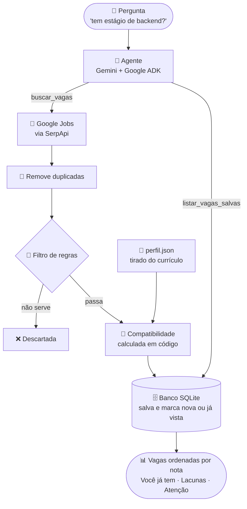

<p align="center">
  
</p>

<p align="center">
  
  
  
  
  
</p>

> [!WARNING]
> 🚧 **Projeto em desenvolvimento.** O agente já busca e analisa vagas reais, mas várias partes ainda estão sendo construídas (veja o [roadmap](#roadmap)).

## 📡 O que é

Agente de IA que procura vagas de **estágio em TI** (Goiânia e remoto), descarta as que não fazem sentido para um estudante e compara cada vaga que sobra com o meu currículo: dá uma nota de compatibilidade, mostra o que eu já tenho e o que falta.

Feito com **Python**, **Google ADK** e **Gemini**, usando vagas reais do **Google Jobs** (via SerpApi).

## 🎯 Por que existe

Procurar estágio em sites de vaga dá muito trabalho manual: metade dos anúncios marcados como "estágio" pede anos de experiência, é de outra área ou é de outra cidade. Este projeto faz esse filtro por mim e ajuda a decidir em quais vagas vale a pena me candidatar primeiro.

## ⚙️ Como funciona



1. **Busca:** o agente transforma o pedido em termos curtos (por exemplo, "dados", "backend") e faz uma busca em Goiânia por termo, mais uma busca de vagas remotas. Sem tema, usa termos gerais de TI.
2. **Limpeza:** a mesma vaga aparece em vários sites com IDs diferentes, então as duplicadas são removidas por título + empresa.
3. **Filtro (só barra com certeza):** uma vaga sai quando
   - não é de TI (nem no título nem na descrição);
   - não é estágio;
   - pede 2 anos ou mais de experiência, ou é pleno/sênior/auxiliar/aprendiz;
   - é presencial fora de Goiânia/Aparecida;
   - é de programação e não usa nenhuma das linguagens que eu sei.

   Na dúvida (informação faltando), a vaga fica.
4. **Compatibilidade (calculada em código, sem modelo):** o programa compara cada vaga com o perfil por palavras-chave, então a mesma vaga sempre recebe a mesma nota. O agente só apresenta o resultado:
   - **nota de 0 a 100**;
   - **Você já tem:** requisitos da vaga que o perfil cobre;
   - **Lacunas:** o que falta;
   - **Atenção:** quando há uma exigência eliminatória (por exemplo, período mínimo da faculdade). Nesse caso a nota fica limitada a 60.

   ```mermaid
   pie showData title Peso da nota de compatibilidade
       "Tecnologias e conhecimentos pedidos" : 70
       "Área e nível da vaga" : 30
   ```

   Dentro dos 70 pontos das tecnologias, as do meu objetivo pesam mais: Python vale 3; FastAPI, LLMs e SQL valem 2; as demais valem 1.

5. **Banco de dados:** as vagas que passaram no filtro são salvas em um banco SQLite local. Cada vaga volta marcada como **Nova** ou **Já vista**, e a nota não é guardada: é recalculada a cada consulta, com as regras e o perfil atuais.

### Outras ferramentas

Além da busca, o agente tem duas ferramentas avulsas:

- **`listar_vagas_salvas`:** deixa perguntar "o que eu já vi de backend?" sem fazer uma busca nova (não gasta a cota da SerpApi).
- **`analisar_vaga`:** recebe o título e o texto de uma vaga colada na conversa, **ou um print dela** (o Gemini lê a imagem e avisa se o print vem cortado), e devolve a mesma análise (nota, o que você já tem, lacunas, atenção). Também mostra **os trechos do currículo mais parecidos com a vaga** (busca por significado, com embeddings do Gemini e ChromaDB): é um apoio para a candidatura e não muda a nota. Não busca vagas nem salva nada.

### Servidor MCP

As ferramentas (`buscar_vagas`, `listar_vagas_salvas`, `analisar_vaga` e `carregar_perfil`) ficam em um **servidor MCP** (`radar_estagio/mcp_server.py`). O agente do ADK liga o servidor como um processo à parte e descobre as ferramentas por ele, em vez de importá-las. As funções continuam em `tools.py`; o servidor só as oferece pelo protocolo. Com isso, qualquer cliente MCP (por exemplo, o Claude Desktop) pode usar o radar, e não só o `adk web`.

```bash
python -m radar_estagio.mcp_server   # fala por stdio: quem conecta é o cliente MCP, não dá para usar direto no terminal
```

> [!NOTE]
> O agente **nunca se candidata nem envia nada** em nome do usuário: ele só busca e organiza.

## 💡 Exemplo de uso

```
Você: tem estágio de dados?

KvSBOT: Encontrei 4 vagas de dados. Da mais compatível para a menos:

1. Estágio em Engenharia de Dados (Empresa X, Goiânia, híbrido)
   Tecnologias: Python, SQL
   Nota: 82
   Você já tem: Python, SQL, PostgreSQL
   Lacunas: Airflow
   Link: ...
```

*(exemplo ilustrativo do formato da resposta)*

## 🛠️ Tecnologias

| Parte | Tecnologia |
|---|---|
| Agente | [Google ADK](https://google.github.io/adk-docs/) |
| Modelo | Gemini |
| Fonte de vagas | Google Jobs via [SerpApi](https://serpapi.com/) |
| Banco de dados | SQLite com [SQLAlchemy](https://www.sqlalchemy.org/) |
| Linguagem | Python 3 |

## 🚀 Como rodar

Pré-requisitos: Python 3, uma chave da [API do Gemini](https://aistudio.google.com/apikey) e uma chave da [SerpApi](https://serpapi.com/) (o plano grátis dá 250 buscas por mês).

```bash
git clone https://github.com/heitorcavss/radar-de-estagio.git
cd radar-de-estagio
python -m venv venv
venv\Scripts\activate        # Windows
# source venv/bin/activate   # Linux/macOS
pip install -r requirements.txt
```

Copie o arquivo de exemplo e preencha suas chaves:

```bash
cp radar_estagio/.env.example radar_estagio/.env
```

Depois, rode a interface do ADK na pasta do projeto e abra o endereço que aparecer no terminal:

```bash
adk web
```

Para usar com o seu currículo, edite `radar_estagio/perfil.json` com a sua formação, habilidades e projetos.

> Cada pergunta sobre vagas gasta de 2 a 4 buscas da SerpApi. Ver as vagas já salvas não gasta nenhuma.
> O banco (`radar_estagio/radar_estagio.db`) é criado sozinho na primeira busca e fica fora do Git.

## 📁 Estrutura

```
radar_estagio/
├── agent.py         # o agente: instruções e ferramentas
├── tools.py         # buscar_vagas, listar_vagas_salvas, analisar_vaga, carregar_perfil e os detectores (TI, estágio, experiência...)
├── filtro.py        # regras que descartam vagas
├── nota.py          # nota de compatibilidade, por palavras-chave
├── banco.py         # banco SQLite: salvar e consultar vagas
├── curriculo_rag.py # busca no currículo por significado (embeddings do Gemini + ChromaDB)
├── mcp_server.py    # servidor MCP: oferece as ferramentas do radar a qualquer cliente MCP
├── perfil.json      # perfil tirado do currículo
├── dados_falsos.py  # vagas falsas do começo do projeto (hoje sem uso)
└── .env.example     # modelo das chaves de API
docs/banner.svg      # banner deste README
NOTAS.md             # diário de decisões, bugs encontrados e o que aprendi
```

## 📓 Decisões e aprendizados

O [NOTAS.md](NOTAS.md) registra o caminho do projeto: por que troquei de fonte de vagas (Adzuna e Gupy foram testados e descartados), os bugs que o filtro teve com vagas reais e como foram resolvidos, e o que aprendi de Python e Git no processo.

<a id="roadmap"></a>

## 🗺️ Roadmap

- [x] Agente com busca de vagas (dados falsos, depois reais)
- [x] Fonte real: Google Jobs via SerpApi
- [x] Filtro de regras (TI, estágio, experiência, cidade, linguagem)
- [x] Perfil do currículo e análise de compatibilidade
- [x] Calcular a nota em código (a mesma vaga sempre dá a mesma nota)
- [x] Salvar as vagas em um banco de dados e marcar nova ou já vista
- [ ] Avaliar a nota contra as minhas próprias notas em 15 a 20 vagas
- [x] Busca por significado no currículo (RAG): a `analisar_vaga` mostra os trechos mais próximos da vaga
- [x] Servidor MCP: as ferramentas ficam em um servidor e o agente as usa por ele
- [x] Avaliar uma vaga por print (imagem), com aviso quando o print vem cortado
- [ ] Refinar a busca no currículo: procurar por requisito da vaga, e não pela descrição inteira (ao final do projeto)
- [ ] Busca por significado (RAG) nas vagas salvas
- [ ] Testes automatizados com `pytest`

## 👤 Autor

**Heitor Cabral**, estudante de Engenharia de Software no IFG.
